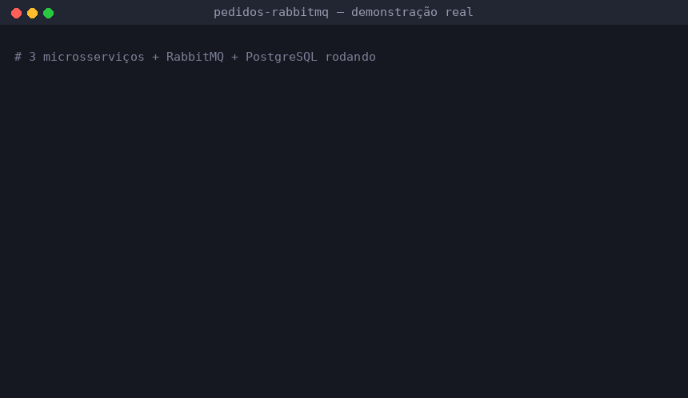
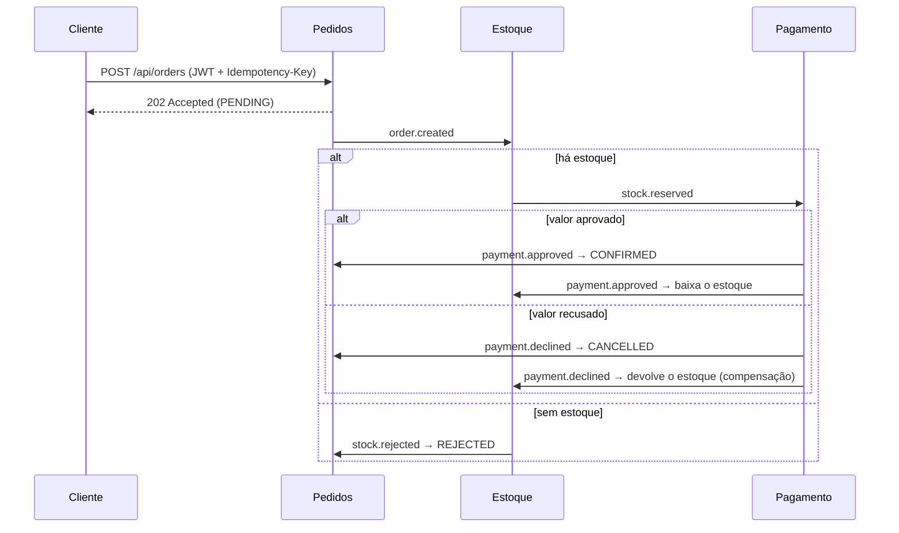

# 📦 Pedidos RabbitMQ: microsserviços com mensageria segura


Sistema de pedidos com três microsserviços (**pedidos**, **estoque** e **pagamento**) que conversam só por eventos no RabbitMQ, no padrão **saga coreografada**. Cada serviço tem o próprio banco.

O foco do projeto é o que costuma dar errado em sistemas distribuídos: **mensagens perdidas, duplicadas, forjadas ou fora de ordem, e vendas acima do estoque**. Cada proteção tem um teste automatizado que a comprova, rodando contra PostgreSQL e RabbitMQ reais.



*Gravado com o sistema rodando de verdade: os três serviços, o RabbitMQ e o PostgreSQL.*

---

## 🔄 Como um pedido flui



Testado de ponta a ponta com os três serviços rodando:

| Pedido | Resultado |
|---|---|
| Teclado + 2 mouses (R$ 528,80) | **CONFIRMED**: estoque reservado, pagamento aprovado, estoque baixado |
| 2 notebooks (R$ 8.599,80) | **CANCELLED**: pagamento recusado, notebooks **devolvidos ao estoque** |
| 50 monitores (há 20) | **REJECTED**: nada foi reservado |
| Pedido feito **com o RabbitMQ fora do ar** | Ficou no outbox, foi publicado quando o broker voltou e terminou **CONFIRMED** |

## 🛡️ Ameaças e defesas

| Ameaça | Defesa | Prova |
|---|---|---|
| **Evento perdido** se o broker cair entre salvar o pedido e publicar | **Outbox transacional**: o evento é gravado na mesma transação do pedido; um relay publica e só marca como enviado após a **confirmação do broker** (publisher confirms) | Pedido feito com o broker parado foi entregue quando ele voltou |
| **Mensagem duplicada** cobrando ou reservando duas vezes | **Inbox**: o id de cada mensagem processada é gravado na mesma transação, e repetições são ignoradas; o pagamento ainda usa o id do pedido como chave primária | `duplicateDeliveryIsProcessedOnlyOnce`, `neverChargesTwiceForTheSameOrder` |
| **Evento forjado** por quem tem acesso ao broker | Toda mensagem é **assinada com Ed25519**; a assinatura cobre id, tipo, produtor, horário e corpo, e é verificada sobre os bytes brutos antes de qualquer conversão | `forgedEventsGoToTheDlqAndDoNotChangeTheOrder` (5 ataques diferentes) |
| **Serviço invadido** tentando se passar por outro | **Chave pública/privada**: cada serviço tem só a própria chave privada e as públicas dos outros, que verificam mas não assinam. Cada tipo de evento só é aceito se assinado pelo **produtor legítimo** | `rejectsEventSignedByAnotherService`, `publicKeyAloneCannotSign` |
| Serviço invadido **publicando eventos de outro** | **Permissões por tópico no RabbitMQ**: pedidos só publica `order.*`, estoque só `stock.*` e pagamento só `payment.*`. Cada um lê só a própria fila e **nenhum pode criar ou apagar filas** | `*UserCannotPublish*` (o broker responde `ACCESS_REFUSED`) |
| **Venda acima do estoque** com pedidos simultâneos | Trava pessimista (`SELECT ... FOR UPDATE`) **sempre na mesma ordem de SKU**, o que evita deadlock; `CHECK (available >= 0)` no banco como última barreira | `concurrentOrdersNeverOversell`: 10 pedidos para 3 unidades resultam em 3 aceitos. **Sem a trava, o teste falha com 10 aceitos** |
| **Fraude no preço** | O cliente informa só produto e quantidade; preço e total vêm do catálogo do servidor, e o preço fica congelado no item | `placesOrderWithServerSidePricesAndPublishesSignedEvent` (envia `"total": 0.01` e é ignorado) |
| **Valor de pagamento adulterado** | O serviço de pedidos só confirma se o valor aprovado for **igual** ao total do pedido | Ataque 4 do teste de eventos forjados |
| **Pedido duplicado** por reenvio do cliente | Cabeçalho `Idempotency-Key` obrigatório, com restrição única no banco; a mesma chave com outro conteúdo responde `409` | `sameIdempotencyKeyReturnsSameOrderAndRejectsDifferentContent` |
| **Mensagem envenenada** travando o consumidor | Mensagem inválida vai **direto para a DLQ**, sem retentativa; falha temporária tem retentativas com espera crescente e depois vai para a DLQ. A *quorum queue* ainda tem **limite de entregas** | Todos os testes de ataque conferem a DLQ |
| **Payload malicioso** | JSON estrito (campo desconhecido, chave duplicada ou lixo no fim rejeitam a mensagem), Bean Validation em todo evento, **nenhuma desserialização Java** e limite de 128 KB por mensagem no broker | `rejectsUnknownFieldsAndInvalidValuesEvenWhenSigned` |
| **Acesso indevido à API** | OAuth2 Resource Server com JWT: algoritmo fixo (HS256), emissor, **audiência**, validade e **escopo** por operação; o que não está liberado é negado | `rejectsMissingForgedExpiredOrUnscopedTokens` |
| **Cliente vendo pedido de outro** | Toda consulta filtra pelo dono; um pedido alheio responde `404`, sem revelar que existe | `customersCannotSeeEachOthersOrders` |
| **Vazamento de detalhes internos** | Erros no padrão RFC 7807, sem stack trace nem SQL; o detalhe vai só para o log | — |
| **Segredos no código** | Nenhum segredo tem valor padrão: sem as variáveis, o serviço não sobe. As chaves são geradas por script e as de teste, a cada execução | — |
| **Banco compartilhado** | Um banco e um usuário por serviço, sem acesso aos dados dos outros | — |
| **Contêiner comprometido** | Usuário sem privilégios, sistema de arquivos **somente leitura** e `no-new-privileges` | — |

## 🏗️ Estrutura

```
common/              Infraestrutura compartilhada: eventos, assinatura Ed25519,
                     leitor seguro de mensagens, outbox, inbox, retentativas e DLQ
order-service/       API REST (JWT) e ciclo de vida do pedido
inventory-service/   Reserva, baixa e devolução de estoque (4 consumidores em paralelo)
payment-service/     Aprovação ou recusa do pagamento (simula antifraude)
infra/rabbitmq/      Filas, bindings, usuários e permissões do broker
infra/postgres/      Um banco e um usuário por serviço
scripts/             Geração de chaves e de tokens de teste
```

## 🛠️ Tecnologias

Java 21 · Spring Boot 3.3 · Spring AMQP · Spring Security (OAuth2 Resource Server) · Spring Data JPA · PostgreSQL 16 · Flyway · RabbitMQ 3.13 (quorum queues, DLX, topic permissions) · JUnit 5 · Testcontainers · Awaitility · Docker · GitHub Actions

## 🚀 Como executar

Requisitos: Docker e OpenSSL.

```bash
git clone https://github.com/Gabriel-Pacheco-K/pedidos-rabbitmq.git
cd pedidos-rabbitmq
./scripts/gerar-chaves.sh       # cria o .env com chaves Ed25519 e senhas novas
docker compose up --build
```

Fazendo um pedido:

```bash
TOKEN=$(./scripts/gerar-token.sh maria)

curl -X POST localhost:8081/api/orders \
  -H "Authorization: Bearer $TOKEN" \
  -H "Idempotency-Key: $(uuidgen)" \
  -H "Content-Type: application/json" \
  -d '{"items":[{"sku":"TECLADO-MEC","quantity":1},{"sku":"MOUSE-USB","quantity":2}]}'
# => 202 Accepted, status PENDING

curl localhost:8081/api/orders/<id> -H "Authorization: Bearer $TOKEN"
# => alguns instantes depois, status CONFIRMED
```

Produtos de exemplo: `NOTEBOOK-15`, `MOUSE-USB`, `TECLADO-MEC`, `MONITOR-27` e `HEADSET-PRO`. Pagamentos acima de R$ 5.000 são recusados.

O painel do RabbitMQ fica em `http://localhost:15672` (usuário `admin`, senha `admin-dev-only`).

> ⚠️ As senhas do RabbitMQ em `infra/rabbitmq/definitions.json` são **só para desenvolvimento**. Em produção elas seriam geradas por ambiente e o arquivo não seria versionado.

## 🧪 Testes

```bash
mvn verify
```

São **29 testes**, a maioria contra PostgreSQL e RabbitMQ reais via Testcontainers. O broker de teste carrega o mesmo `definitions.json` do Compose, então os testes exercitam as mesmas filas e permissões de produção, e cada serviço conecta com o próprio usuário de privilégio mínimo.

- **common (9)**: assinatura, corpo adulterado, produtor errado, tipo inesperado, mensagem antiga, campos extras ou inválidos e chaves inválidas
- **pedidos (10)**: preço no servidor, idempotência, validação, JWT (forjado, vencido, sem escopo ou com audiência errada), isolamento entre clientes, eventos forjados, duplicatas e permissões do broker
- **estoque (6)**: reserva tudo ou nada, compensação, **concorrência sem venda acima do estoque**, eventos forjados e permissões
- **pagamento (4)**: limite de aprovação, cobrança única e eventos forjados

## 🧭 Limitações conhecidas e próximos passos

- **JWT com segredo compartilhado (HS256)**: em produção, os tokens viriam de um provedor de identidade com chaves assimétricas (RS256/ES256 via JWKS).
- **Rotação de chaves**: hoje há uma chave por serviço. O próximo passo seria um identificador de chave (`kid`) para trocar chaves sem parar o sistema.
- **Limpeza do inbox**: a tabela de mensagens processadas cresce para sempre; precisaria de uma rotina que apague registros mais antigos que a idade máxima de mensagem.
- **Retentativa do outbox**: o relay tenta a cada 500 ms com o broker fora do ar; um backoff exponencial reduziria o ruído nos logs.
- **TLS** entre os serviços, o RabbitMQ e o PostgreSQL.
- **Observabilidade**: rastreamento distribuído (OpenTelemetry) seguindo o pedido pelos três serviços.

---

Desenvolvido por **Gabriel Pacheco Kiesel**: [Portfólio](https://gabriel-pacheco-k.github.io) · [LinkedIn](https://www.linkedin.com/in/gabriel-pacheco-3b637a362/) · [GitHub](https://github.com/Gabriel-Pacheco-K)
